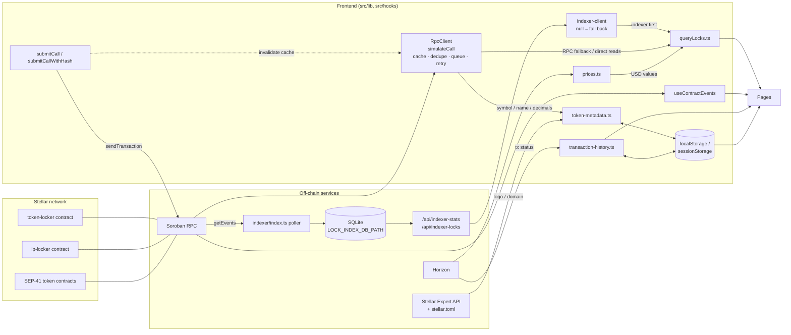
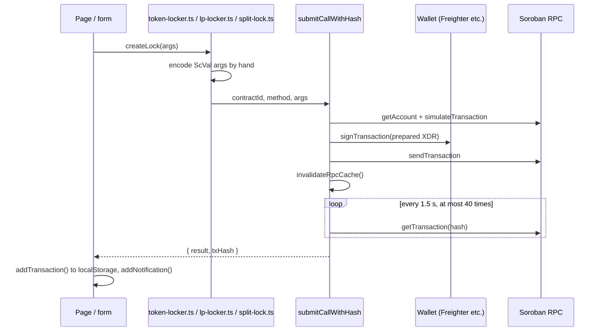

# Architecture: data flow from chain to UI

How data gets from the Soroban contracts to each page of the frontend, which
source backs which page, and what happens when a source is unavailable.

This collects facts that were spread across [data-sourcing.md](./data-sourcing.md),
[ADR-003](./adr/ADR-003-serverless-architecture.md),
[ADR-012](./adr/ADR-012-rpc-client-caching.md),
[indexer-architecture.md](./indexer-architecture.md) and comments in `src/lib/`.
Those documents stay the reference for their own topic; this page is the map.

## Data sources

| Source | What it provides | Accessed through | Cache |
|---|---|---|---|
| **Soroban RPC (simulate)** | Authoritative lock reads (`get_lock`, `get_locks_by_*`, `get_lock_count_by_*`), token `balance`/`allowance`, SEP-41 `symbol`/`name`/`decimals` | `simulateCall` → `RpcClient` in [src/lib/stellar.ts](../src/lib/stellar.ts) | In-memory, 10 s TTL, in-flight dedupe, max 5 concurrent, 3 retries (ADR-012) |
| **Soroban RPC (submit)** | Writes: `create_lock`, `create_split_lock`, `withdraw`, `extend`, `transfer_beneficiary`, token `approve` | `submitCall` / `submitCallWithHash` in `stellar.ts` | None. A successful send clears the read cache (`invalidateRpcCache`) |
| **Soroban RPC (`getEvents`)** | Live contract events for the activity feed | [src/hooks/useContractEvents.ts](../src/hooks/useContractEvents.ts) via `ContractEventProvider` | None (polling) |
| **Indexer API** | Site-wide aggregates and per-token lock pages, from SQLite | `/api/indexer-stats`, `/api/indexer-locks` → [src/lib/indexer-client.ts](../src/lib/indexer-client.ts) | In-memory, 10 s TTL, 100 entries max; failures are not cached |
| **Horizon** | XLM/USD price (USDC/XLM order book); transaction status for History | [src/lib/prices.ts](../src/lib/prices.ts), [src/lib/transaction-history.ts](../src/lib/transaction-history.ts) | Prices: in-memory, 60 s TTL |
| **Stellar Expert API + `stellar.toml`** | Token logo, domain and "verified" flag for avatars | `getTokenMetadata` in [src/lib/token-metadata.ts](../src/lib/token-metadata.ts) | localStorage, 24 h per entry |
| **`/verified-tokens.json`** | Static allow-list behind the verified badge | [src/hooks/useVerifiedToken.ts](../src/hooks/useVerifiedToken.ts) | In-memory, per network |
| **localStorage / sessionStorage** | Wallet session, transaction history, drafts, notifications, preferences | Various hooks; see [browser-storage.md](./browser-storage.md) | n/a |

## Diagram

## Read path rules

1. **Lock reads go through [src/lib/queryLocks.ts](../src/lib/queryLocks.ts)**, wrapped
   by the hooks in [src/hooks/useLocks.ts](../src/hooks/useLocks.ts). Pages should not call
   `token-locker.ts`, `lp-locker.ts` or `indexer-client.ts` directly to read data.
2. **Indexer first, RPC fallback.** An indexer function returning `null` means "use RPC".
   Site-wide stats are the exception: there is no RPC equivalent, so they degrade to zeros
   with `source: "fallback"`. Details: [data-sourcing.md](./data-sourcing.md).
3. **USD values are always computed in the browser** by `withUsdValues` / `fetchPricesBatch`.
   Only native XLM has a price feed. Every Soroban token contract (`C…`) is priced at `0`, so
   `hasPriceFeed()` should be checked before showing `$0.00` as a real value.
4. **Token metadata comes from two different places.** Amounts and symbols use on-chain
   `getOnChainTokenMeta` (RPC, in-memory cache, falls back to the first 6 characters of the
   address and 7 decimals). Avatars use `getTokenMetadata` (Stellar Expert + `stellar.toml`,
   24 h localStorage cache).

## Per-page data sources

Routes are defined in [src/App.tsx](../src/App.tsx).

| Page (route) | Primary source | Fallback when it fails | Notes |
|---|---|---|---|
| Landing (`/`) | `querySiteStats` → indexer `/api/indexer-stats` | Zeroed stats, `source: "fallback"` | Hero TVL is the sum of the indexer's `topTokens` (up to 50) × browser-side price |
| Discover (`/explore`) | `useDiscoverStats` → `querySiteStats` | Zeroed stats. The hook reports `source: "indexer"` even in this case | Recent activity panel comes from `useContractEvents` (RPC `getEvents`), not the indexer |
| Explorer (`/explore/:token`) | `queryLocksByToken` → indexer `/api/indexer-locks` | RPC `get_locks_by_token`, also used when the indexer page has no `kind: "token"` rows | Count for pagination: indexer `total`, else RPC `get_lock_count_by_token`. Contract link: `explorerLink()` |
| Analytics (`/app/analytics`) | `useDiscoverStats` (same as Discover) | Zeroed charts | Time-series charts only use the indexer's `recentLocks` + `upcomingUnlocks` sample, not every lock |
| My Locks (`/app/locks`) | `queryMyLocks` → **RPC only** (`get_locks_by_creator` / `_by_beneficiary` on both contracts) | None. RPC errors are shown as an error | Loads up to `ALL_LOCKS_LIMIT` (10 000) and paginates on the client. View mode is read from localStorage |
| Lock detail (`/app/lock/token/:id`, `/app/lock/lp/:id`, `/app/lock/:id`) | `queryTokenLock` / `queryLpLock` → **RPC only** (`get_lock`) | None | Writes go through `submitCallWithHash`; `useOptimisticLock` shows the expected result until the next RPC read. Writes add an entry to tx history |
| Create lock (`/app/create`) | RPC: token `balance`, `allowance`, `decimals`; `estimateLockCost` simulation | n/a | Form drafts in localStorage, wizard state in sessionStorage, 60 s per-wallet cooldown in localStorage |
| Lock created (`/app/lock-created`) | Router `location.state` from the create flow | Redirects away if no state | Tx link built from `NETWORK.networkName` |
| History (`/app/history`) | localStorage `stellarlock:tx_history` | Empty list | Pending entries are refreshed from Horizon `/transactions/:hash`. Links use the network stored with each record |
| Settings (`/app/settings`) | localStorage (address book, notification preferences) | Empty defaults | Email/webhook subscriptions call `/api/notifications/*` |
| Health (`/health`) | Direct `fetch` to Soroban RPC `/health` and Horizon `/` | Shows the service as down | Does not use `RpcClient` |

## Why numbers and links differ between pages

- **Totals: indexer vs RPC.** Landing, Discover and Analytics read the indexer, which can lag
  the chain by the poller interval or be missing entirely (zeros). My Locks and Lock detail read
  RPC directly. A lock created a few seconds ago can show on My Locks before it shows on Discover.
- **TVL scope.** Site TVL sums the indexer's top tokens only, while My Locks "Total Value
  Locked" sums the user's own created locks. Both are `0` for any token without a price feed,
  which is currently every Soroban token.
- **Analytics charts use a sample.** Charts are built from recent and upcoming locks only, so
  they will not match the headline totals.
- **Caches.** RPC reads can be up to 10 s old, indexer reads 10 s, prices 60 s, token avatars
  24 h. A successful write clears only the RPC read cache.
- **Explorer links.** `explorerLink()` and Lock created use the network the app is currently
  built for (`NETWORK.networkName`), while History uses the network saved on each record. A record
  created on testnet keeps a testnet link after the app switches to mainnet. The network key
  comes from `resolveNetworkKey()` ([src/lib/network-key.ts](../src/lib/network-key.ts)), so
  `staging` uses mainnet.
- **Symbols.** If an RPC metadata call fails, the symbol falls back to the first 6 characters of
  the contract address and decimals fall back to 7. That changes both the label and the displayed
  amount.

## Write path

Arguments are encoded by hand. [contract-call-surface.md](./contract-call-surface.md) lists
every method the frontend calls and the signature it has to match.
